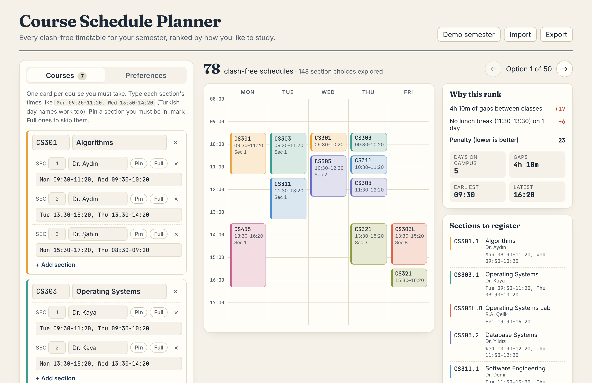

# Course Schedule Planner

[](https://github.com/zafwr/course-schedule-planner/actions/workflows/ci.yml)

**Live demo: [zafwr.github.io/course-schedule-planner](https://zafwr.github.io/course-schedule-planner/)**

Every registration week, students try section combinations by hand until something fits. This app does it properly: enter your courses and their sections, and it finds **every** clash-free timetable, ranks them by how you like to study (no 8:30 classes, a free Friday, fewer gaps, a lunch break, …) and exports your pick to Google Calendar.



## Features

- **Exhaustive search.** All valid section combinations, not just the first one found. The demo semester (7 courses, 18 sections, 648 possible combinations) has 78 valid timetables, found after trying only 148 section choices.
- **Explained ranking.** Each option lists exactly why it ranks where it does: `+17  4h 10m of gaps`, `−8  1 free weekday`.
- **Real registration constraints.** Pin a section you must be in, mark full sections to skip them.
- **Helpful when nothing fits.** It tells you which pair of courses can never be taken together, instead of just saying "no results".
- **Catalog-style input.** Type `Mon 09:30-11:20, Wed 13:30-14:20`; Turkish day names (`Pzt`, `Salı`, `Çarşamba`, …) work too.
- **Calendar export.** Downloads an `.ics` file with weekly recurring events for the semester (Google Calendar, Outlook, Apple Calendar).
- **Private by design.** Runs entirely in the browser. Plans autosave locally and can be exported/imported as JSON. Light and dark themes.

## How it works

Choosing one section per course so that no two overlap is a **constraint satisfaction problem**: courses are variables, sections are their domains and "these two sections overlap" is the constraint. The solver ([`src/core/solver.ts`](src/core/solver.ts)) is a backtracking search with two standard improvements:

1. **Forward checking.** After a section is picked, every remaining course immediately drops its sections that clash with it. If some course has nothing left, the branch is abandoned before going deeper.
2. **Minimum remaining values (MRV).** The next course to fill is always the one with the fewest options left, so dead ends are found as early as possible.

The search is capped at 5,000 schedules to keep the UI responsive on huge inputs. A test compares the solver against brute force on randomly generated semesters to make sure pruning never loses a valid schedule.

Ranking ([`src/core/scoring.ts`](src/core/scoring.ts)) is a weighted penalty: each preference adds or removes points, and ties are broken by fewer gaps and then an earlier finish. Because every point comes with a label, the ranking is transparent rather than a black box.

The calendar export ([`src/core/ics.ts`](src/core/ics.ts)) follows RFC 5545: `RRULE:FREQ=WEEKLY;UNTIL=…` events starting on the first matching weekday of the semester, escaped text and line folding at 75 bytes without splitting UTF-8 characters (so "Çarşamba" survives).

## Run locally

Requires Node.js 20+.

```bash
git clone https://github.com/zafwr/course-schedule-planner.git
cd course-schedule-planner
npm install
npm run dev      # http://localhost:5173
npm test         # 28 unit tests (Vitest)
npm run build    # type-check and production build into dist/
```

## Project structure

```
src/
  core/            Framework-free logic, fully unit tested
    solver.ts      Backtracking CSP solver (forward checking + MRV)
    scoring.ts     Preferences, schedule statistics and ranking
    ics.ts         iCalendar export
    time.ts        Parsing "Mon 09:30-11:20" (English and Turkish)
    plan.ts        Validation for imported JSON plans
    sample.ts      Fictional demo semester
  ui/              React components (editor, preferences, week grid)
  App.tsx
.github/workflows/ci.yml   Tests, build and GitHub Pages deploy
```

The core has no React dependency, so the same solver could back a CLI, a mobile app or a university's registration system.

## Tech

TypeScript, React 19, Vite, Vitest, GitHub Actions, GitHub Pages.

## License

MIT
